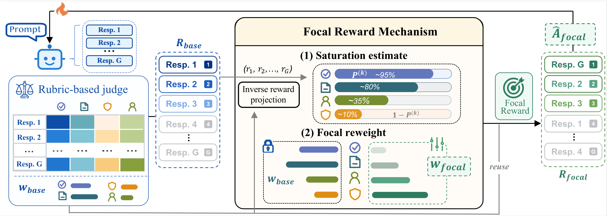
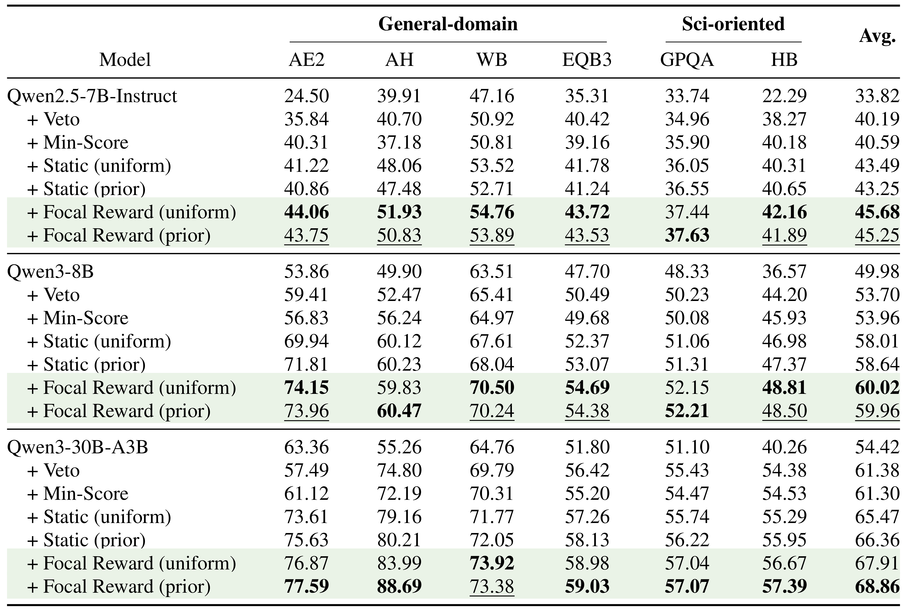

# Focal Reward

**Focal Reward: Balanced Reinforcement Learning under Rubric-Based Rewards**  
Yu Huang, Zihua Zhao, Zhaoxin Huan, Wanli Gu, Feng Hong, Xinmu Ge, Lin Yuan, Weichang Wu, Qiang Hu, Xiaolu Zhang, Jun Zhou, and Jiangchao Yao  
NeurIPS 2026

[Paper (arXiv)](https://arxiv.org/abs/2605.26579)

## Overview

Open-ended generation often requires several rubric criteria. With fixed reward weights, easy criteria can saturate while important constraints remain unmet. Focal Reward estimates criterion saturation during training and dynamically reallocates reward weight toward criteria that still have room to improve.

Across three model scales and six benchmarks, Focal Reward outperformed the strongest static aggregation baseline in all 18 model–benchmark comparisons.

## Code

Coming soon.
