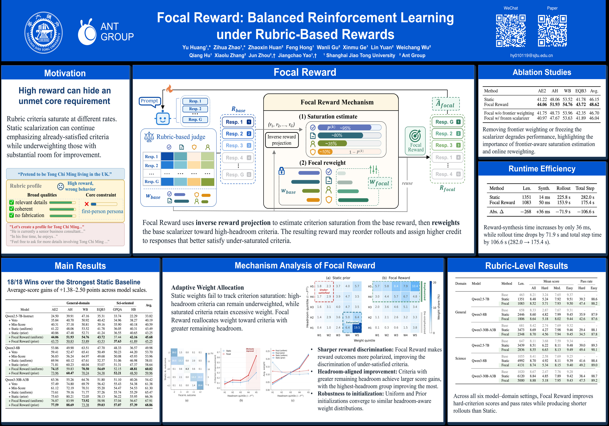

# Focal Reward

**Focal Reward: Balanced Reinforcement Learning under Rubric-Based Rewards**  
Yu Huang, Zihua Zhao, Zhaoxin Huan, Wanli Gu, Feng Hong, Xinmu Ge, Lin Yuan, Weichang Wu, Qiang Hu, Xiaolu Zhang, Jun Zhou, and Jiangchao Yao  
NeurIPS 2026

[Paper (arXiv)](https://arxiv.org/abs/2605.26579)

## Poster

## Code

Coming soon.
